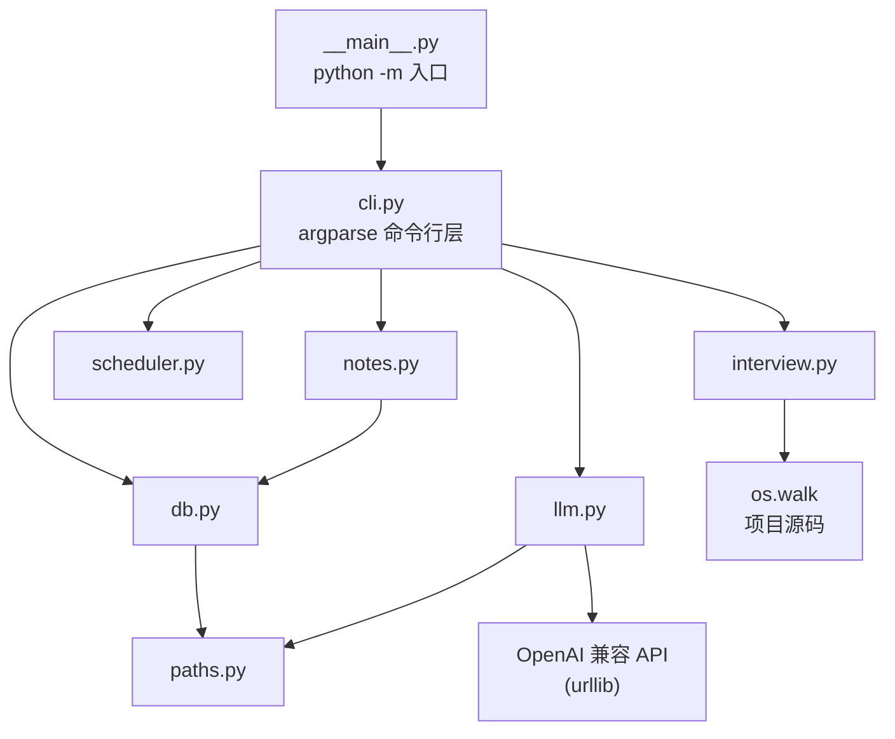
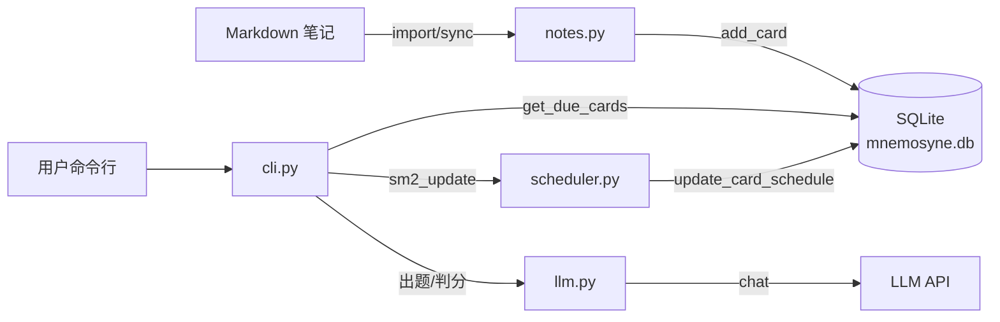
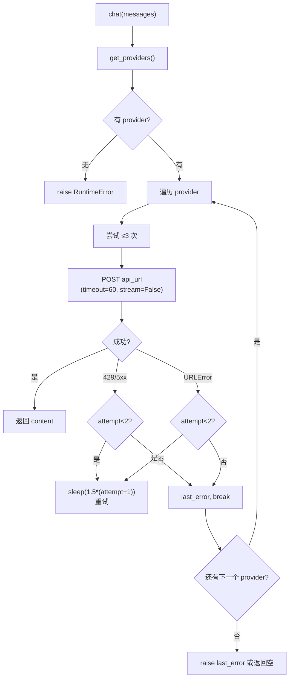
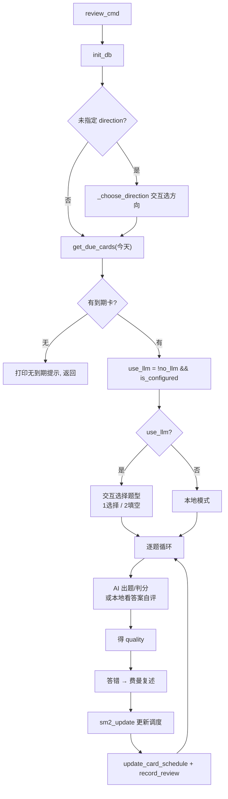
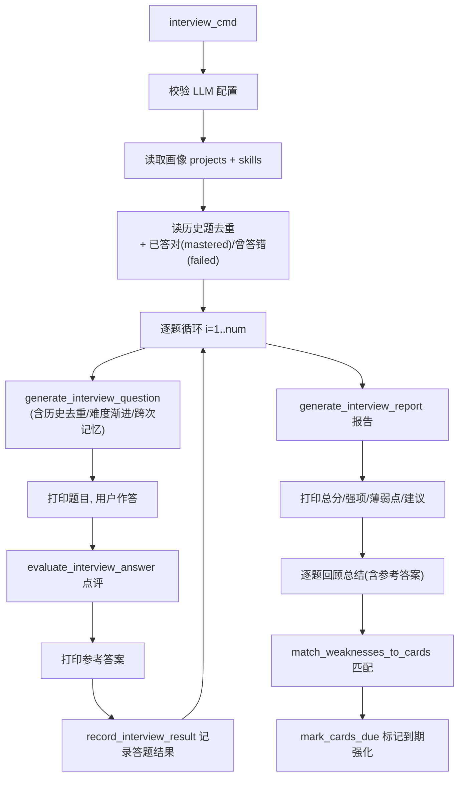

# Mnemosyne 技术手册

> 遗忘曲线学习助手 —— 本地优先的间隔重复学习记忆工具
>
> 版本：`0.1.0` · 许可证：`GPL-3.0-only` · Python ≥ 3.8

---

## 目录

1. [项目概述](#1-项目概述)
2. [技术栈与依赖](#2-技术栈与依赖)
3. [目录结构](#3-目录结构)
4. [系统架构](#4-系统架构)
5. [数据层 `db.py`](#5-数据层-dbpy)
6. [路径解析 `paths.py`](#6-路径解析-pathspy)
7. [Markdown 解析 `notes.py`](#7-markdown-解析-notespy)
8. [SM-2 调度算法 `scheduler.py`](#8-sm-2-调度算法-schedulerpy)
9. [LLM 集成 `llm.py`](#9-llm-集成-llmpy)
10. [面试采集 `interview.py`](#10-面试采集-interviewpy)
11. [命令行层 `cli.py`](#11-命令行层-clipy)
12. [配置参考](#12-配置参考)
13. [错误处理与降级策略](#13-错误处理与降级策略)
14. [扩展指南](#14-扩展指南)

---

## 1. 项目概述

Mnemosyne 是一个**本地优先**（local-first）的个人学习记忆工具。核心思想：

1. 把 Markdown 笔记自动拆分为**知识点卡片**（`#` 主题 / `##` 知识点）；
2. 用 **SM-2 间隔重复算法**（基于艾宾浩斯遗忘曲线）调度每日复习；
3. 可选接入 **OpenAI 兼容 LLM** 做智能出题、判分与模拟面试；
4. 未配置 LLM 时自动**降级**为本地交互式复习，永不阻塞学习。

核心特性：

| 特性 | 说明 |
|------|------|
| 零第三方依赖 | 仅用 Python 标准库（`sqlite3`、`urllib`、`argparse`、`json` 等） |
| 学科分区 / 方向 | 卡片按「分区（subject）」+「方向（direction）」二级分类 |
| SM-2 个性化 | 调度算法结合用户学习画像动态调节复习间隔 |
| 多模型故障切换 | 主 LLM 崩溃自动切换备用模型，退避重试 |
| 模拟面试 | 读项目源码由易到难出题，结束出报告并回填复习卡 |
| 数据兼容迁移 | 旧库自动迁移列名 / 目录 / 回填方向 |

---

## 2. 技术栈与依赖

| 类别 | 选型 | 说明 |
|------|------|------|
| 语言 | Python ≥ 3.8 | 使用 f-string、类型注解、`dataclasses` 未使用 |
| 包管理 | setuptools + pipx | `pyproject.toml` 声明构建与命令行入口 |
| 数据库 | SQLite（`sqlite3`） | 单文件数据库，存于数据目录 |
| HTTP 客户端 | `urllib.request` | 直连 OpenAI 兼容 API，无 `requests` 依赖 |
| CLI | `argparse` | 子命令 + 子子命令（`subject`、`profile`） |
| 调度算法 | SM-2（自制实现） | `scheduler.py` |
| 内容解析 | 自制 Markdown 解析器 | `notes.py` |

**依赖声明**（`pyproject.toml`）：

```toml
[project]
name = "Mnemosyne_pipx"
version = "0.1.0"
requires-python = ">=3.8"
license = "GPL-3.0-only"

[project.scripts]
mnemosyne = "mnemosyne_pipx.cli:main"

[build-system]
requires = ["setuptools>=61.0", "wheel"]
build-backend = "setuptools.build_meta"
```

> 注意：`requires-python` 下无 `dependencies` 字段，即**运行时零第三方依赖**，这是本项目的一大设计亮点——仅凭标准库即可运行，极大降低部署成本。

---

## 3. 目录结构

```
Mnemosyne_pipx/
├── pyproject.toml              # 构建与打包配置
├── README.md                   # 用户向说明
├── LICENSE                     # GPL-3.0-only
├── USER_MANUAL.md              # 使用手册
├── FEATURE_MANUAL.md           # 功能手册
├── DEVELOPMENT_LOG.md          # 开发日志
├── TECHNICAL_MANUAL.md         # 本文件
└── src/
    └── mnemosyne_pipx/
        ├── __init__.py         # __version__ = "0.1.0"
        ├── __main__.py         # python -m 入口
        ├── cli.py              # 命令行层（最大模块）
        ├── db.py               # 数据访问层
        ├── notes.py            # Markdown 解析
        ├── scheduler.py        # SM-2 调度
        ├── llm.py              # LLM 集成
        ├── interview.py        # 面试源码采集
        └── paths.py            # 数据目录解析
```

> `build/lib/` 与 `src/Mnemosyne_pipx.egg-info/` 为打包产物，非手写源码。

---

## 4. 系统架构

### 4.1 模块依赖关系



### 4.2 分层视图

```
┌─────────────────────────────────────────────────┐
│  表示层  cli.py（argparse 子命令 + 交互输入）     │
├─────────────────────────────────────────────────┤
│  业务层  notes.py / scheduler.py / interview.py │
├─────────────────────────────────────────────────┤
│  集成层  llm.py（出题/判分/面试，多模型容错）    │
├─────────────────────────────────────────────────┤
│  数据层  db.py（SQLite CRUD + 迁移 + 统计）      │
├─────────────────────────────────────────────────┤
│  基础层  paths.py（数据目录解析）                │
└─────────────────────────────────────────────────┘
```

### 4.3 数据流总览



---

## 5. 数据层 `db.py`

### 5.1 数据目录

数据库默认路径由 `paths.py` 的 `get_data_dir()` 决定：

| 平台 | 默认数据目录 |
|------|------------|
| Windows | `%LOCALAPPDATA%\mnemosyne` |
| macOS / Linux | `$XDG_DATA_HOME/mnemosyne`，未设置时为 `~/.local/share/mnemosyne` |

可通过环境变量 `MNEMOSYNE_DATA_DIR` 覆盖。数据库文件为 `mnemosyne.db`，附件目录为 `files/`。

```python
DEFAULT_DB = os.path.join(get_data_dir(), 'mnemosyne.db')
DEFAULT_FILE_DIR = os.path.join(get_data_dir(), 'files')
```

### 5.2 数据库表结构

#### 表 `cards` —— 复习卡片（核心表）

| 字段 | 类型 | 默认 | 说明 |
|------|------|------|------|
| `id` | INTEGER | 自增主键 | 卡片 ID |
| `question` | TEXT NOT NULL | — | 问题（知识点标题） |
| `answer` | TEXT NOT NULL | — | 答案 |
| `examples` | TEXT | NULL | JSON 数组字符串 |
| `files` | TEXT | NULL | 附件文件名 JSON 数组 |
| `tags` | TEXT | NULL | 逗号分隔标签 |
| `subject` | TEXT | NULL | 学科分区（英语/嵌入式/数学…） |
| `direction` | TEXT | NULL | 方向（二级分类） |
| `created_at` | TEXT | — | UTC ISO 时间 |
| `updated_at` | TEXT | — | UTC ISO 时间 |
| `ease` | REAL | 2.5 | SM-2 易度因子（下限 1.3） |
| `interval` | INTEGER | 0 | 复习间隔（天） |
| `repetition` | INTEGER | 0 | 连续答对次数 |
| `next_review` | TEXT | NULL | 下次复习日期 |

#### 表 `subjects` —— 学科分区

| 字段 | 类型 | 说明 |
|------|------|------|
| `id` | INTEGER | 主键 |
| `name` | TEXT UNIQUE NOT NULL | 分区名（唯一） |
| `description` | TEXT | 描述 |
| `created_at` | TEXT | UTC ISO 时间 |

内置分区：`英语`、`嵌入式`、`数学`（`DEFAULT_SUBJECTS`）。

#### 表 `reviews` —— 复习记录

| 字段 | 类型 | 说明 |
|------|------|------|
| `id` | INTEGER | 主键 |
| `card_id` | INTEGER | 关联卡片 |
| `reviewed_at` | TEXT | 复习时间 |
| `quality` | INTEGER | 自评/判分 0-5 |
| `feynman` | TEXT | 费曼复述文本（可空） |

#### 表 `profiles` —— 学习画像

| 字段 | 类型 | 默认 | 说明 |
|------|------|------|------|
| `id` | INTEGER | 主键 | — |
| `name` | TEXT | — | 姓名 |
| `difficulty` | TEXT | 'normal' | easy/normal/hard |
| `study_hours_per_day` | REAL | 1.0 | 每日学习时长 |
| `notes` | TEXT | NULL | 备注 |
| `skills` | TEXT | NULL | 专业技能（技能分类 + 关键词，用于面试出题） |
| `projects` | TEXT | NULL | 项目经验（项目名 + 技术栈与实现描述，用于面试出题） |
| `weaknesses` | TEXT | NULL | 薄弱点标签 JSON 数组（`[{"tag": str, "streak": int}]`，连续答对消除） |
| `updated_at` | TEXT | — | 更新时间 |

#### 表 `interview_log` —— 面试题记录（跨次记忆）

| 字段 | 类型 | 说明 |
|------|------|------|
| `id` | INTEGER | 主键 |
| `question` | TEXT | 问过的题 |
| `topic` | TEXT | 面试范围（c/stm32/mix） |
| `score` | INTEGER | 得分（0-5） |
| `user_answer` | TEXT | 候选人回答 |
| `correct` | INTEGER | 是否答对（0/1，评分 ≥ 3 记为 1） |
| `knowledge_point` | TEXT | 知识点标签（跨次去重/换问法依据） |
| `reference` | TEXT | 技术正确要点（判分参考） |
| `difficulty` | TEXT | 难度（easy/medium/hard） |
| `created_at` | TEXT | 时间 |

#### 表 `weakness_history` —— 薄弱点出题历史

| 字段 | 类型 | 说明 |
|------|------|------|
| `id` | INTEGER | 主键 |
| `weakness_tag` | TEXT | 薄弱点标签 |
| `question` | TEXT | 结合薄弱点出的题（原始知识点题干） |
| `answer` | TEXT | 参考答案 |
| `qtype` | TEXT | 题型（choice/fill） |
| `correct` | INTEGER | 是否答对（0/1） |
| `created_at` | TEXT | 时间 |

### 5.3 建表与迁移逻辑

`init_db(path=None)` 负责建表与**兼容迁移**，关键点：

1. `CREATE TABLE IF NOT EXISTS` 建立所有表；
2. 读取 `PRAGMA table_info(cards)` 检测旧列；
3. 旧版 `images` 列 → `ALTER TABLE ... RENAME COLUMN images TO files`；
4. 缺 `subject` 列 → `ADD COLUMN subject`；
5. 缺 `direction` 列 → `ADD COLUMN direction`，随后调用 `_backfill_directions()`；
6. 旧目录 `images/` → 重命名为 `files/`；
7. 内置分区 `INSERT OR IGNORE`（幂等）；
8. `profiles` 缺 `skills` 列 → 补充；缺 `weaknesses` 列 → 补充；
9. 新建 `weakness_history` 表（薄弱点出题历史）；
10. `interview_log` 缺 `score`/`correct`/`knowledge_point` 等列 → 逐个 `ADD COLUMN` 补充（兼容旧库）。

```python
def _backfill_directions(cur):
    """兼容旧库：为「嵌入式」卡片按来源标签回填方向。幂等。"""
    cur.execute("UPDATE cards SET direction='编程语言' WHERE subject='嵌入式' AND (direction IS NULL OR direction='') AND tags LIKE '%md:C语言%'")
    cur.execute("UPDATE cards SET direction='MCU' WHERE subject='嵌入式' AND (direction IS NULL OR direction='') AND tags LIKE '%md:STM32%'")
```

### 5.4 数据访问函数清单

| 函数 | 作用 |
|------|------|
| `_from_json(s)` | 安全解析 TEXT 列 JSON，容错返回 `[]` |
| `init_db(path)` | 建表 + 迁移，返回路径 |
| `get_conn(path)` | 获取 SQLite 连接 |
| `add_card(...)` | 插入卡片（含附件复制、分区登记） |
| `update_card(...)` | 更新卡片内容 |
| `get_card(card_id)` | 查询单卡（dict） |
| `delete_card(card_id)` | 删除卡片及关联复习记录 |
| `list_cards(subject, direction)` | 列表查询（可筛选） |
| `get_cards_by_tag(tag)` | 按来源标签 `md:<文件名>` 精确匹配 |
| `get_due_cards(as_of, ...)` | 查询到期卡片（`next_review IS NULL` 或 ≤ 今天） |
| `list_directions(subject)` | 列出已有方向（去重） |
| `update_card_schedule(...)` | 更新调度字段 |
| `mark_cards_due(card_ids)` | 标记卡片今日到期（强化训练） |
| `record_review(...)` | 写入复习记录 |
| `set_profile(...)` / `get_profile()` | 画像读写 |
| `get_stats()` | 学习统计 |
| `add_subject(...)` / `list_subjects()` | 分区管理 |
| `record_interview_questions(...)` / `get_recent_interview_questions(...)` | 面试题去重 |
| `record_interview_result(...)` | 记录一道面试题的答题结果（得分/对错/知识点） |
| `get_mastered_interview_questions(...)` | 读取已答对面试题（出题避开） |
| `get_failed_interview_questions(...)` | 读取已答错面试题（下次换问法） |
| `list_interview_history(...)` | 读取面试历史（题目/得分/对错/知识点/难度/时间） |
| `get_weaknesses(...)` | 读取画像薄弱点列表（`[{tag, streak}]`） |
| `set_weaknesses(...)` | 覆盖写入画像最新一行薄弱点 |
| `add_weakness_tags(tags)` | 合并新薄弱点标签（去重，streak 从 0 开始） |
| `bump_weakness_streak(tag, correct)` | 薄弱点连续答对计数；答对 +1（达阈值消除）、答错归零 |
| `record_weakness_question(...)` | 记录结合薄弱点出的题（含题型/对错） |
| `get_weakness_history(...)` | 读取最近薄弱点出题历史（供 AI 出题去重） |
| `export_db(out_path)` | 导出所有卡片为 JSON |

### 5.5 关键实现细节

**附件存储**：`add_card`/`update_card` 调用 `_store_files()`，将用户指定文件复制到 `files/` 目录，重名自动加后缀 `_1`、`_2`，最终只存文件名（JSON 数组）。

**标签查询**：`get_cards_by_tag` 使用 `LIKE` 精确匹配技巧，避免误匹配：

```sql
SELECT ... FROM cards WHERE ',' || tags || ',' LIKE '%,<tag>,%'
```

**到期判定**：`get_due_cards` 中 `next_review IS NULL OR DATE(next_review) <= DATE(?)`，将「从未复习」与「已到期」一并纳入。

---

## 6. 路径解析 `paths.py`

```python
def get_data_dir():
    configured = os.environ.get('MNEMOSYNE_DATA_DIR')
    if configured:
        return os.path.abspath(os.path.expanduser(configured))
    if os.name == 'nt':
        base_dir = os.environ.get('LOCALAPPDATA') or os.path.expanduser('~')
    else:
        base_dir = os.environ.get('XDG_DATA_HOME') or os.path.join(os.path.expanduser('~'), '.local', 'share')
    return os.path.join(base_dir, 'mnemosyne')
```

优先级：`MNEMOSYNE_DATA_DIR` 环境变量 > 平台默认位置。

---

## 7. Markdown 解析 `notes.py`

### 7.1 解析规则

| Markdown 结构 | 语义 |
|--------------|------|
| `# 标题`（一级） | **主题**，作为标签写入卡片，并作为后续 `##` 的 topic |
| `## 标题`（二级） | **知识点**，作为卡片的问题（question） |
| 二级标题之间的正文 | **答案**（answer，保留换行） |

### 7.2 `parse_markdown(text)`

逐行扫描，维护 `topic`（最近一级标题）、`current_q`（当前知识点）、`current_a`（答案行缓冲）。遇到新的 `##` 或 `#` 时 `flush()` 当前缓冲。

**注意**：仅当 `answer` 非空时才生成卡片；`## ` 与 `# ` 均要求标题后紧跟空格。

返回 `[{'question': str, 'answer': str, 'topic': Optional[str]}, ...]`。

### 7.3 `import_markdown_file(path, tags, subject, direction, db_path)`

1. 读取文件（UTF-8）；
2. `parse_markdown` 得到知识点列表；
3. 为每张卡追加标签：用户标签 + `topic` 标签 + 来源标签 `md:<文件名去扩展名>`；
4. 逐个 `db.add_card`。

返回导入卡片数。

### 7.4 `sync_markdown_file(path, tags, subject, direction, db_path)`

与 import 不同，sync **保留学习进度**：

1. 用来源标签 `md:<文件名>` 查出现有卡片（`get_cards_by_tag`）；
2. 以「`##` 标题文字完全一致」为键建立映射 `by_question`；
3. 遍历新解析结果：
   - 命中已存在 → `update_card`（更新答案/标签，保留 ease/interval/repetition），`updated += 1`；
   - 未命中 → `add_card`（新增卡片），`added += 1`。

返回 `(updated, added)`。

---

## 8. SM-2 调度算法 `scheduler.py`

### 8.1 算法背景

SM-2（SuperMemo-2）是经典的间隔重复算法。核心状态三字段：

- **ease**（易度因子 EF）：初始 2.5，随答题质量调整，下限 1.3；
- **interval**（间隔天数）：成功复习的间隔递增；
- **repetition**（连续答对次数）：答错归零。

### 8.2 完整公式

```python
def sm2_update(ease, interval, repetition, quality, profile=None):
    # quality: 0-5（0=全错，5=全对）
    if quality < 3:
        # 未掌握：重置
        repetition = 0
        interval = 1
    else:
        # 已掌握：递增间隔
        if repetition == 0:
            interval = 1
        elif repetition == 1:
            interval = 6
        else:
            interval = max(1, int(round(interval * ease)))
        repetition += 1

    # 更新易度因子（标准 SM-2 EF 公式）
    ease = ease + (0.1 - (5 - quality) * (0.08 + (5 - quality) * 0.02))
    if ease < 1.3:
        ease = 1.3

    # 基于学习画像的间隔调节
    multiplier = 1.0
    if profile and isinstance(profile, dict):
        diff = profile.get('difficulty', 'normal')
        mapping = {'easy': 1.2, 'normal': 1.0, 'hard': 0.8}
        multiplier = mapping.get(diff, 1.0)

        hours = profile.get('study_hours_per_day')
        try:
            if hours is not None:
                h = float(hours)
                if h < 0.5:
                    multiplier *= 0.8      # 学习时间少 → 更保守
                elif h > 2:
                    multiplier *= 1.05     # 学习时间多 → 稍激进
        except Exception:
            pass

    adjusted_interval = max(1, int(round(interval * multiplier)))
    next_review = date.today() + timedelta(days=adjusted_interval)
    return ease, adjusted_interval, repetition, next_review.isoformat()
```

### 8.3 易度因子 EF 更新表（不同 quality 下）

EF 增量 = `0.1 - (5-q) × (0.08 + (5-q) × 0.02)`：

| quality | (5-q) | EF 增量 | 效果 |
|---------|-------|---------|------|
| 5 | 0 | +0.10 | 涨（卡片变易） |
| 4 | 1 | 0.00 | 不变 |
| 3 | 2 | -0.14 | 略降 |
| 2 | 3 | -0.32 | 降 |
| 1 | 4 | -0.54 | 明显降 |
| 0 | 5 | -0.80 | 大幅降 |

### 8.4 间隔递进表（不含画像修正）

| 连续答对次数 | 间隔 |
|-------------|------|
| 首次（repetition 0→1） | 1 天 |
| 第 2 次（1→2） | 6 天 |
| 第 3 次起 | `round(interval × ease)` |

### 8.5 个性化修正

| 画像维度 | 影响 |
|---------|------|
| `difficulty = easy` | 间隔 × 1.2（更宽松） |
| `difficulty = normal` | × 1.0 |
| `difficulty = hard` | × 0.8（更严格） |
| 每日学习 < 0.5h | 再 × 0.8（保守） |
| 每日学习 > 2h | 再 × 1.05（激进） |

---

## 9. LLM 集成 `llm.py`

### 9.1 配置加载

**优先级**：环境变量 > 配置文件（`<data_dir>/config.json`）。

```python
CONFIG_PATH = os.path.join(get_data_dir(), 'config.json')
_ENV_KEYS = {
    'api_key': 'MNEMOSYNE_LLM_API_KEY',
    'api_url': 'MNEMOSYNE_LLM_API_URL',
    'model':  'MNEMOSYNE_LLM_MODEL',
}
```

配置文件支持三种写法：

```json
// 1. 单模型（平铺）
{"api_key": "...", "api_url": "...", "model": "..."}

// 2. 包一层 llm
{"llm": {"api_key": "...", "api_url": "...", "model": "..."}}

// 3. 多模型故障切换（推荐）
{"providers": [
    {"name": "deepseek", "api_key": "...", "api_url": "https://api.deepseek.com/v1/chat/completions", "model": "deepseek-chat"},
    {"name": "glm", "api_key": "...", "api_url": "https://open.bigmodel.cn/api/paas/v4/chat/completions", "model": "glm-4-flash"}
]}
```

`load_config()` 读取文件后，再用环境变量覆盖；`get_providers()` 把配置规范化为 provider 列表。

**provider 名推断**（`_default_provider_name`）：根据 `api_url` 包含的关键字推断可读名称：

| URL 关键字 | 推断名 |
|-----------|--------|
| `deepseek` | deepseek |
| `bigmodel` / `zhipu` | glm |
| `dashscope` / `aliyun` | qwen |
| `siliconflow` | siliconflow |
| 其他 | model 名 |

### 9.2 核心调用 `chat(messages, max_tokens, temperature)`

**多模型故障切换 + 退避重试**：



关键实现：

```python
for provider in providers:
    for attempt in range(3):
        # 构造 payload：model / messages / max_tokens / temperature / stream=False
        req = urllib.request.Request(api_url, data=json.dumps(payload).encode('utf-8'),
            headers={'Authorization': 'Bearer ' + api_key, 'Content-Type': 'application/json'},
            method='POST')
        try:
            with urllib.request.urlopen(req, timeout=60) as resp:
                data = json.loads(resp.read().decode('utf-8'))
        except urllib.error.HTTPError as e:
            if e.code in (429, 500, 502, 503, 504) and attempt < 2:
                time.sleep(1.5 * (attempt + 1)); continue
            last_error = e; break
        except urllib.error.URLError as e:
            if attempt < 2:
                time.sleep(1.5 * (attempt + 1)); continue
            last_error = e; break
        # 解析 choices[0].message.content
```

**退避策略**：`sleep(1.5 * (attempt + 1))` 秒 → 第 1 次重试等 1.5s、第 2 次等 3s。

**provider 切换提示**：`_note_provider(name)` 用全局 `_active_provider` 去重，仅在模型真正切换时打印一次 `[LLM] 当前模型服务：xxx`。

### 9.3 LLM 函数清单

| 函数 | 用途 | 返回 |
|------|------|------|
| `is_configured()` | 是否有可用 provider | bool |
| `generate_question(q)` | 围绕知识点出简答题 | str |
| `extract_weakness_tags(wrong_items)` | 从答错题中提炼薄弱知识点标签 | `List[str]` |
| `generate_choice_question(q, a, weakness_tags, weakness_history)` | 生成单选题（可结合薄弱点强化） | `{'question','options','correct','weakness_tag'}` 或 None |
| `generate_fill_blank_question(q, a, weakness_tags, weakness_history)` | 生成填空题（可结合薄弱点强化） | `{'question','answer','weakness_tag'}` 或 None |
| `generate_card(topic, direction)` | AI 出题 + 标准答案（两层第一层） | `(question, answer)` |
| `evaluate_answer(q, ref, user)` | 判分 0-5 | `(score, feedback)` 或 (None,None) |
| `generate_interview_question(...)` | 面试出题（由易到难，含跨次记忆策略） | `{'question','reference','difficulty','knowledge_point'}` |
| `evaluate_interview_answer(q, ref, user)` | 面试点评 | `(score, feedback)` |
| `generate_interview_report(history)` | 面试报告 | 结构化 dict |
| `match_weaknesses_to_cards(weak, cards)` | 薄弱点匹配卡片 | `List[Optional[int]]` |

其中 `_weakness_prompt_block(weakness_tags, weakness_history)` 是内部辅助函数：根据画像薄弱点与出题历史拼装「薄弱点强化」提示块，要求 AI 在当前知识点能与薄弱点自然关联时出结合题，并避开历史已出过的题；无薄弱点时返回空串。

### 9.4 JSON 解析健壮性

所有需要结构化输出的 prompt 都要求 LLM「严格只输出 JSON」，解析时用正则兜底：

```python
m = re.search(r'\{.*\}', content, re.S)   # 从文本中抠出第一个 JSON 对象
obj = json.loads(m.group(0)) if m else json.loads(content)
```

解析失败时各类函数的降级行为：

- `generate_question` → 返回原始知识点；
- `generate_card` → 返回 `(topic, topic)`；
- 其余结构化函数 → 返回 `None`，由上层转为本地模式。

### 9.5 面试出题 prompt 设计要点

`generate_interview_question` 的 system prompt 是「软件工程面试官」，用户消息包含 9 条严格约束，核心设计：

1. **通用化**：不允许问「代码第几行写了什么」，禁止引用具体函数名/变量名/宏名；
2. **应届生视角**：难度匹配校招，三档定义明确（easy=单一知识点唯一答案，medium=适度综合，hard=设计权衡/并发/工程经验）；
3. **难度渐进**：前 1/3 题 easy、中 1/3 medium、后 1/3 hard，由 `round_no/total` 决定；
4. **去重多样性**：注入「历史问过的题」列表，要求换知识点，避免重复问同类题；
5. **紧扣项目经验与专业技能**：优先围绕 `project_experience`（项目经验）与 `professional_skills`（专业技能）出题，问候选人实际做过、写进简历的技术；
6. **跨次记忆策略**：注入「已答对（mastered）」与「曾答错（failed）」知识点列表——已答对的务必避开（含换汤不换药的题），曾答错的换一个问法/角度重新考察帮助巩固；
7. **结构化输出**：JSON `{question, reference, difficulty, knowledge_point}`，其中 `reference` 是判分参考的「技术正确要点」不展示给候选人，`knowledge_point` 是本题考察的核心知识点标签（供跨次去重/换问法）。

---

## 10. 面试辅助 `interview.py`

### 10.1 `collect_project_context(project_root)`（历史遗留）

读取项目源码作为背景素材（该函数在新版中已不再被面试流程调用；面试已改为读取画像中的项目经验与专业技能）。保留以兼容旧用法。

| 常量 | 值 | 说明 |
|------|-----|------|
| `SOURCE_EXTENSIONS` | `.c .h .cpp .hpp .py .js .jsx .ts .tsx .java .go .rs .cs` | 支持的语言 |
| `IGNORED_DIRS` | `.git .hg .svn .venv venv node_modules __pycache__ build dist` | 忽略目录 |
| `MAX_PROJECT_FILES` | 30 | 最多采集文件数 |
| `MAX_FILE_CHARS` | 6000 | 单文件最大字符数 |

流程：

1. `project_root` 取 `MNEMOSYNE_PROJECT_ROOT` 环境变量或当前工作目录；
2. `os.walk` 递归遍历，过滤忽略目录与点开头目录；
3. 按扩展名过滤、跳过 > 1MB 文件；
4. 读文件（UTF-8，`errors='replace'` 容错），超 6000 字符截断并加 `...(truncated)...`；
5. 以 `===== 相对路径 =====` + 内容组织，达 30 文件即返回。

### 10.2 `format_history(history)`

把面试问答历史格式化为 LLM 可读文本，答案超过 300 字符截断，用于出题时感知候选人表现。

---

## 11. 命令行层 `cli.py`

### 11.1 入口

```python
# __main__.py
from .cli import main
if __name__ == '__main__':
    raise SystemExit(main())
```

`main()` 关键细节：**Windows GBK 控制台兼容**——打印前对 stdout/stderr 调 `reconfigure(errors='replace')`，遇到无法编码字符（如 emoji）用 `?` 替代，避免崩溃。

### 11.2 命令清单

| 命令 | 处理函数 | 说明 |
|------|---------|------|
| `add` | `add_cmd` | 手动添加（`--q/--a`）或 AI 出题（`--topic`） |
| `import` | `import_cmd` | 导入 Markdown |
| `sync` | `sync_cmd` | 同步 Markdown（保留进度） |
| `list` | `list_cmd` | 列出卡片 |
| `review` | `review_cmd` | 复习到期卡片 |
| `interview` | `interview_cmd` | AI 模拟面试 |
| `interview history` | `interview_history_cmd` | 查看面试历史题目 |
| `export` | `export_cmd` | 导出 JSON |
| `show` | `show_cmd` | 查看卡片详情 |
| `subject list` / `subject add` | `subject_list_cmd` / `subject_add_cmd` | 分区管理 |
| `profile set` / `profile show` | `profile_set_cmd` / `profile_show_cmd` | 学习画像 |

### 11.3 路径推断逻辑

```python
KNOWN_SUBJECTS = ('英语', '嵌入式', '数学')
EXCLUDED_DIRECTIONS = ('笔试题',)

def _infer_subject(path):
    """Makedown/嵌入式/编程语言/C/x.md → 嵌入式"""
    # 从路径末尾向前找第一个命中 KNOWN_SUBJECTS 的目录名

def _infer_direction(path, subject):
    """学科分区下的直接子目录，如 编程语言 / MCU"""
    # 找到 subject 目录索引后，取下一个目录名作为方向
    # 若方向名在 EXCLUDED_DIRECTIONS（笔试题）中则返回 None
```

### 11.4 复习流程 `review_cmd`



**关键设计**：

- **随时退出**：内嵌 `QuitReview` 异常；在题型选择、选择题/填空题作答、本地自评、费曼复述等输入点检测到 `#quit` 时抛出，在 `finally` 中输出本次总结后退出；
- **对错统计**：`correct_count` / `wrong_count` 计数，答错题目记入 `wrong_items` 供结束提炼薄弱点；
- **薄弱点强化**：复习开始读取画像薄弱点，AI 出题时传入 `weakness_tags` 与出题历史；结合薄弱点出的题记录进 `weakness_history`，并据对错更新 `bump_weakness_streak`（连续答对 2 次消除）；
- **结束总结**：`finally` 块中打印答对/答错数，若有答错题则调 `extract_weakness_tags` 提炼标签并 `add_weakness_tags` 写入画像；
- **AI 连续失败降级**：`ai_failures` 计数达 3 时 `use_llm = False`，剩余题目切本地模式；
- **题型处理函数**：内嵌 `run_choice`（单选判对错）与 `run_fill`（填空判分），失败返回 `(None, None)` 触发本地模式；
- **费曼复述**：仅 AI 模式且 `quality < 3`，或显式 `--feynman` 时，提示一句话复述，写入 `reviews.feynman`；
- **进度显示**：每轮打印 `[复习进度] index/total，已完成，剩余`；
- **调度入参**：`ease or 2.5`、`interval or 0`、`repetition or 0`（首卡容错）。

### 11.5 面试流程 `interview_cmd`



**薄弱点回填闭环**：面试发现的薄弱点 → 匹配卡库最相关卡片 → `mark_cards_due`（`next_review` 设为今天、`interval`/`repetition` 归零）→ 下次 `review` 自动调出强化训练。

**跨次记忆闭环**：每题评分后调 `record_interview_result` 写入 `interview_log`（`correct = score ≥ 3`）；下次面试出题时读 `get_mastered_interview_questions`（已答对，避开）与 `get_failed_interview_questions`（曾答错，换问法再考），按知识点标签去重。

### 11.6 `mark_cards_due` 语义

```python
UPDATE cards SET next_review=?, interval=0, repetition=0, updated_at=? WHERE id=?
```

将卡片强制置为「今日到期」，是面试 → 复习闭环的关键桥接函数。

---

## 12. 配置参考

### 12.1 环境变量汇总

| 变量 | 作用 |
|------|------|
| `MNEMOSYNE_DATA_DIR` | 数据目录（覆盖默认） |
| `MNEMOSYNE_LLM_API_KEY` | LLM API Key |
| `MNEMOSYNE_LLM_API_URL` | LLM API URL |
| `MNEMOSYNE_LLM_MODEL` | LLM 模型名 |
| `MNEMOSYNE_PROJECT_ROOT` | 面试源码根目录（历史遗留，面试已改为画像驱动，不再使用） |

### 12.2 命令示例

```powershell
# 导入（自动推断分区/方向）
mnemosyne import --file 嵌入式/MCU/STM32_I2C基础版.md

# 显式指定
mnemosyne import --file notes.md --subject 嵌入式 --direction MCU

# 同步（保留进度）
mnemosyne sync --file notes.md

# AI 出题添加
mnemosyne add --topic "I2C 总线" --direction MCU

# 复习（选择题）
mnemosyne review --subject 嵌入式 --type choice

# 复习（本地模式）
mnemosyne review --no-llm

# 模拟面试（依据画像项目经验与专业技能）
mnemosyne interview --topic stm32 --num 8

# 查看面试历史题目
mnemosyne interview history
mnemosyne interview history --correct wrong --detail

# 画像（含项目经验与专业技能）
mnemosyne profile set --name 小明 --difficulty hard --study-hours 0.5 --projects "项目经验..." --skills "C 语言(熟练);STM32(掌握)"

# 导出
mnemosyne export --out backup.json
```

---

## 13. 错误处理与降级策略

| 场景 | 处理 |
|------|------|
| 未配置 LLM 时 `--topic` | 直接报错退出（提示需配置） |
| 未配置 LLM 时 `review` | 自动退回本地交互模式 |
| LLM 出题失败（单题） | 该题切本地模式，不中断整体复习 |
| LLM 连续失败 3 次 | 剩余题目全部切本地模式 |
| 限流 429 / 5xx / 网络中断 | provider 内退避重试（1.5s、3s）最多 3 次 |
| 主 provider 连续失败 | 自动切换备用 provider |
| 全部 provider 失败 | 复习降级本地；面试中断并提示 |
| LLM 返回非 JSON | 正则抠 JSON；仍失败则按函数语义降级 |
| 面试出题失败 | 中断本次面试（`break`） |
| 面试点评失败 | `score = 0`，继续 |
| 报告生成失败 | 打印「未能生成报告」，面试仍结束 |
| 提炼薄弱点失败 | 打印提示，不阻塞复习结束总结 |
| Windows 控制台编码错误 | `reconfigure(errors='replace')` 兜底 |
| 附件文件不存在 | `_store_files` 静默跳过 |
| 旧库/旧目录 | `init_db` 自动迁移 |

---

## 14. 扩展指南

### 14.1 新增 LLM provider

在 `config.json` 的 `providers` 数组追加即可，无需改代码：

```json
{"providers": [
  {"name": "deepseek", "api_key": "...", "api_url": "https://api.deepseek.com/v1/chat/completions", "model": "deepseek-chat"},
  {"name": "qwen", "api_key": "...", "api_url": "https://dashscope.aliyuncs.com/compatible-mode/v1/chat/completions", "model": "qwen-plus"}
]}
```

`_default_provider_name` 会自动识别 `dashscope` 关键字。如需识别新服务商，可在该函数中追加关键字分支。

### 14.2 新增学科分区

```powershell
mnemosyne subject add --name 物理 --desc "大学物理"
```

或直接调用 `db.add_subject(name, description)`。若要预置为默认分区，在 `db.DEFAULT_SUBJECTS` 中加入即可。

### 14.3 调整调度策略

`sm2_update` 中的画像修正映射表是唯一调节点：

```python
mapping = {'easy': 1.2, 'normal': 1.0, 'hard': 0.8}
```

### 14.4 新增命令

在 `build_parser()` 中 `sp.add_parser(...)` 注册子命令，`set_defaults(func=xxx_cmd)` 绑定处理函数，再实现 `xxx_cmd(args)` 即可。

### 14.5 注意事项

- **数据库 schema 变更**需在 `init_db` 中写 `PRAGMA table_info` 检测 + `ALTER TABLE` 迁移逻辑，保持向后兼容；
- **LLM 结构化输出**务必保留正则兜底 `re.search(r'\{.*\}', ...)`，防止模型输出前后夹带文字导致 `json.loads` 失败；
- 时间统一用 `datetime.utcnow().isoformat()`，日期用 `date.today().isoformat()`，SQL 比较时用 `DATE()` 函数对齐。

---

*本手册基于源码 `0.1.0` 版本梳理，随代码演进请同步更新。*
